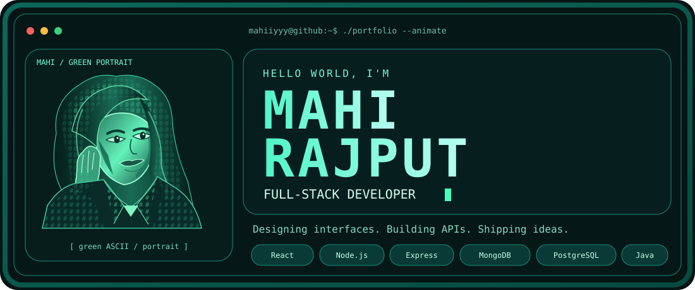

**Full-Stack Developer** · Building digital experiences from idea to deployment

  

## 🌈 The person behind the pixels

I'm a **full-stack developer** and B.Tech **Computer Science & Business Systems** student at **Oriental Institute of Science and Technology** (2023–2027). I enjoy turning ideas into polished, practical applications—with a particular interest in **frontend engineering, backend APIs, and thoughtful UI/UX**.

- 🔭 Building full-stack projects and exploring AI-powered developer tools
- 🧠 Improving my problem-solving skills with **Java and DSA**
- 🛠️ Working with **React, Node.js, Express, MongoDB, and PostgreSQL**
- 🎯 Open to **Frontend, Full-Stack, and Software Engineering internships**

## 🧩 My creative toolkit

**Languages & frontend**

**Backend & databases**

**Workflow & tools**

## 🎮 Things I've built

| Project | What it does | Stack |
| --- | --- | --- |
| 🛡️ **[CyberLens](https://github.com/mahiiyyy/CyberLens)** | Cybersecurity-focused project exploring email threat detection and analysis. | Explore the repository for implementation details |
| 🛒 **[OneeCart](https://github.com/mahiiyyy/Onee-Cart)** | Full-stack e-commerce experience with product management and a responsive storefront. | React · Node.js · Express · MongoDB |
| ☁️ **[Weather App](https://github.com/mahiiyyy/skylar-weather-app)** | Weather-focused web app. | Explore the repository for implementation details |

> My favorite kind of project? One that feels as good to use as it does to build. ✨

## ✨ My coding universe

Explore my repositories for current project languages and contribution activity.

---

**Let's build something that makes people say “whoa.” 🚀**

[Let's talk](mailto:mahirajput0710@gmail.com) · [LinkedIn](https://www.linkedin.com/in/mahii-rajput) · [Repositories](https://github.com/mahiiyyy?tab=repositories)

Made with 💜, curiosity & way too many browser tabs

